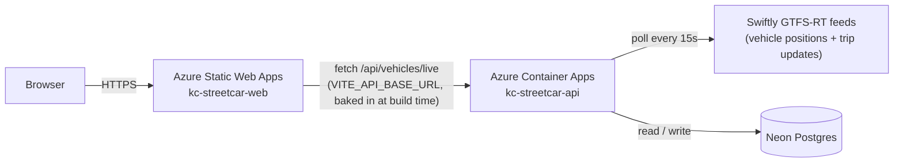
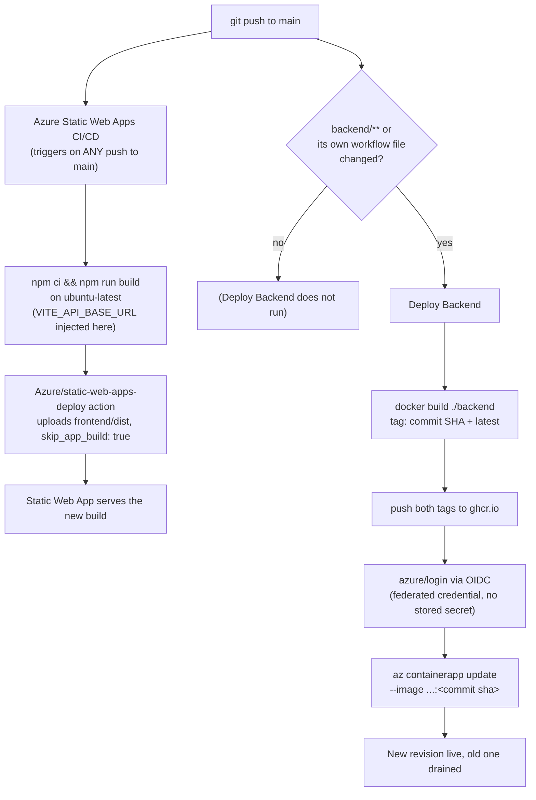

# CI/CD Pipeline

This document describes how KC Streetcar Tracker is hosted and deployed. For the phased history of how this setup was built, including issues encountered along the way, see [deployment.md](./deployment.md).

## Quick reference

| Thing | Value |
|---|---|
| Frontend | https://streetcartracker.com (default hostname https://proud-island-0a037380f.6.azurestaticapps.net still works) |
| Backend API | https://api.streetcartracker.com (default hostname https://kc-streetcar-api.mangoground-3203ab82.eastus2.azurecontainerapps.io still works) |
| Domain registrar | Cloudflare (`streetcartracker.com`), DNS only, not proxied |
| Resource group | `kc-streetcar` (East US 2) |
| Static Web App | `kc-streetcar-web` |
| Container App | `kc-streetcar-api` (Consumption plan, `kc-streetcar-env` environment) |
| Backend image | `ghcr.io/alexmwebber/kc-streetcar-backend` (public) |
| Database | Neon Postgres, project in `us-east-2` |
| Azure AD app (backend CI auth) | `kc-streetcar-github-actions`, client ID `09824957-b323-498c-a1fc-b041f534fb94` |
| Monthly budget alert | `kc-streetcar-monthly-20`, $20/mo, subscription-wide |

## Runtime architecture



The backend runs as a single always-on process that serves the `/api/vehicles/*` and `/health` routes and polls the GTFS-RT vehicle-positions and trip-updates feeds every 15 seconds in the background ([poller.ts](../backend/src/services/poller.ts)). The Container App is pinned to exactly one replica (`--min-replicas 1 --max-replicas 1`): scaling to zero would stop the poller, and more than one replica would produce duplicate polling and duplicate rows in Neon.

## Deploy pipeline

Two independent GitHub Actions workflows handle deployment, split by which part of the repository changed:



**[azure-static-web-apps-proud-island-0a037380f.yml](../.github/workflows/azure-static-web-apps-proud-island-0a037380f.yml)** triggers on every push to `main`; it currently has no path filter, so a backend-only push also runs it. It builds the frontend on the standard `ubuntu-latest` runner rather than letting the deploy action delegate the build to Azure's own auto-builder ("Oryx"). Oryx's build container ships an older glibc than the Rollup native binary pulled in by `vite build` requires, which causes the build to fail (see deployment.md, Phase 4). Authentication uses a deployment token that Azure generated and stored as the `AZURE_STATIC_WEB_APPS_API_TOKEN_PROUD_ISLAND_0A037380F` repository secret when the Static Web App was created.

**[deploy-backend.yml](../.github/workflows/deploy-backend.yml)** triggers only on pushes touching `backend/**` (or the workflow file itself). It builds and pushes the Docker image tagged both `:latest` and `:<commit-sha>`, then updates the Container App to that exact SHA tag. Tagging by SHA, rather than only `:latest`, keeps the running image traceable to the exact commit that produced it and allows rollback without rebuilding (see Rolling back, below).

## Auth: how the backend pipeline reaches Azure

No Azure credential is stored in GitHub as a plain secret:

1. An Azure AD app registration (`kc-streetcar-github-actions`) has a **federated credential** trusting GitHub's OIDC issuer for a specific subject: `repo:alexmwebber@26013687/kc-streetcar@1347814895:ref:refs/heads/main` (GitHub includes immutable owner/repo IDs in this claim, not just names).
2. On each run, the GitHub Actions runner mints a short-lived OIDC token asserting that it is a run of that exact repository and branch. The `azure/login@v2` step exchanges it for an Azure access token; no password or secret is transmitted, and the token is valid only for that job run.
3. The app registration's service principal is granted the **Container Apps Contributor** role, scoped to the `kc-streetcar` resource group only (not the subscription), limiting it to managing Container Apps within that group.
4. `AZURE_CLIENT_ID`, `AZURE_TENANT_ID`, and `AZURE_SUBSCRIPTION_ID` are stored as repository secrets. These are identifiers only (which app registration, tenant, and subscription to use) and do not by themselves grant access without a matching GitHub OIDC token for this repository and branch.

The frontend pipeline's authentication is simpler: a deployment token scoped to that one Static Web App, generated by Azure and stored as a secret automatically.

## Configuration and secrets

**Frontend (build-time only):** `VITE_API_BASE_URL` is set as an `env:` value on the workflow's build step and is inlined into the JS bundle by Vite at build time ([vehicles.ts](../frontend/src/api/vehicles.ts)). It is not configurable at runtime; a change to the backend URL requires rebuilding and redeploying the frontend.

**Backend (Container App env vars / secrets)**, set via `az containerapp update`:

| Name | Kind | Value |
|---|---|---|
| `SWIFTLY_API_KEY` | secret (`swiftly-key`) | Swiftly GTFS-RT API key |
| `DATABASE_URL` | secret (`db-url`) | Neon pooled connection string (`sslmode=require&channel_binding=require`) |
| `GTFS_RT_BASE_URL` | plain | Swiftly base URL; backend appends `/gtfs-rt-vehicle-positions` and `/gtfs-rt-trip-updates` |
| `STREETCAR_ROUTE_ID` | plain | `601` |
| `POLL_INTERVAL_MS` | plain | `15000` |
| `PORT` | plain | `3001` |
| `CORS_ORIGIN` | plain | `https://streetcartracker.com,https://proud-island-0a037380f.6.azurestaticapps.net` (comma-separated list; defaults to `*` if unset - see [config.ts](../backend/src/config.ts)) |

## Custom domain

Registered at Cloudflare, DNS records set to "DNS only" (not proxied) so Azure's own TLS certificates and domain validation work directly against the origin.

| Record | Type | Value | Purpose |
|---|---|---|---|
| `@` (apex) | TXT | Azure-generated token | Ownership validation for `streetcartracker.com` (frontend) |
| `@` (apex) | CNAME | `proud-island-0a037380f.6.azurestaticapps.net` | Routes the apex to the Static Web App (Cloudflare flattens root CNAMEs) |
| `asuid.api` | TXT | Azure-generated token(s) | Ownership/domain-control validation for `api.streetcartracker.com` (backend) |
| `api` | CNAME | `kc-streetcar-api.mangoground-3203ab82.eastus2.azurecontainerapps.io` | Routes `api.streetcartracker.com` to the Container App |

The frontend domain uses TXT validation (`az staticwebapp hostname set --validation-method dns-txt-token`), the only method Static Web Apps supports for apex domains. The backend's managed certificate uses **CNAME** validation (`az containerapp hostname bind --validation-method CNAME`), not TXT - see the failure mode below for why.

## Making a change

Changes deploy automatically on push to `main`; there is no separate deploy step.

- Changes under `frontend/` trigger the Static Web Apps workflow, which rebuilds and redeploys (approximately 1-2 minutes).
- Changes under `backend/` trigger the Deploy Backend workflow, which builds a new image and rolls it into Container Apps (approximately 2-3 minutes).
- Changes to both trigger both workflows, which run independently and in parallel.

To test a backend change locally before pushing:
```
cd backend
npm run build
docker build -t kc-streetcar-backend .
docker run --rm -p 3001:3001 --env-file .env kc-streetcar-backend
```
For the frontend, `npm run dev` in `frontend/` uses the Vite dev proxy to `localhost:3001` (see [vite.config.ts](../frontend/vite.config.ts)), requiring no environment variable configuration for local development.

## Rolling back

**Backend** - two methods:
- *Without rebuilding:* every image is retained in `ghcr.io` tagged by commit SHA, so the Container App can be pointed directly at a known-good tag: `az containerapp update -n kc-streetcar-api -g kc-streetcar --image ghcr.io/alexmwebber/kc-streetcar-backend:<old-sha>`. This takes effect immediately and does not require a CI run.
- *Through the pipeline:* `git revert <bad-commit>` followed by a push rebuilds and redeploys the reverted code, and records the rollback in git history.

**Frontend:** `git revert` followed by a push is the standard method, since there is no separate image registry to reference an older build. The Azure portal also retains prior Static Web Apps deployments, which can be viewed without using git.

## Debugging a failed deploy

1. **GitHub Actions** (`github.com/alexmwebber/kc-streetcar/actions`) - both workflows log every step; a failed run links directly to the failing step's output.
2. **Backend runtime, once deployed:**
   - `az containerapp logs show -n kc-streetcar-api -g kc-streetcar --tail 50` - application logs (should show `API listening...` and steady `[poller] stored N position(s)` lines).
   - `az containerapp revision list -n kc-streetcar-api -g kc-streetcar -o table` - lists revision health and traffic weight, to confirm the new revision is receiving traffic.
   - `az containerapp show -n kc-streetcar-api -g kc-streetcar --query properties.template.containers[0]` - confirms the exact image, env vars, and probes currently live.
3. **Frontend deployment status:** `az staticwebapp environment list -n kc-streetcar-web -g kc-streetcar`. GitHub Actions logs are the primary debugging source for the frontend deployment; Azure's CLI provides less visibility into Static Web Apps than into Container Apps.

**Known failure modes** (see deployment.md for full details):
- `GLIBC_2.32' not found` during the frontend build - caused by Oryx's build container shipping an older glibc than the Rollup native binary requires. The workflow builds on `ubuntu-latest` directly to avoid this.
- `permission_denied: write_package` when pushing to ghcr.io - the package is not linked for this repository's Actions access. Resolve via package Settings → Manage Actions access → add the repository with Write access.
- `AADSTS700213: No matching federated identity record...` - the federated credential's subject does not match the value GitHub presents (for example, after a repository rename or transfer, or a change to GitHub's claim format). Resolve by reading the exact subject from the error and updating it with `az ad app federated-credential update`.
- An unescaped `&` (or `|`, `^`, `%`) in a value passed to `az` from PowerShell - split by the `cmd.exe` layer `az.cmd` runs through, corrupting the command. Resolve by placing the value in a JSON/YAML file and passing it via `--parameters @file`, `--body @file`, or `--yaml @file` instead of inlining it.
- `az containerapp hostname bind --validation-method TXT` fails with `Operation timed out` - the domain-control-validation window for a managed certificate's TXT check is shorter than it appears (the "up to 20 minutes" message describes total issuance time, not the DCV window), typically too short for a human to read the token, add it at the DNS provider, and confirm. Each attempt also creates a new managed-certificate resource with its own token, so a failed attempt's certificate must be deleted (`az containerapp env certificate delete`) before retrying. If a CNAME for the hostname already points at the Container App, use `--validation-method CNAME` instead - Azure validates against the existing record immediately, with nothing new to add.
- A pipeline step shaped like `command-that-can-fail | gzip > file` (or any `cmd1 | cmd2`) reports the exit code of the *last* command, not the first. A failing `pg_dump` piped into `gzip` still "succeeds" and uploads a small, useless artifact. Always add `set -euo pipefail` to multi-line `run:` steps that pipe commands together.

## Backups

**[backup-db.yml](../.github/workflows/backup-db.yml)** runs `pg_dump` daily (`0 9 * * *` UTC) against Neon's direct (non-pooled) connection - PgBouncer's transaction pooling mode doesn't reliably support everything `pg_dump` needs - and uploads the gzipped result as a GitHub Actions artifact (30-day retention). Also runnable on demand via `workflow_dispatch`.

`pg_dump` must match the server's major Postgres version (Neon currently runs 18); the workflow runs it from the official `postgres:18-alpine` Docker image rather than an apt-installed client, since Ubuntu's default package lags behind. Bump that image tag if Neon's version ever changes.

A green run is not proof of a good backup - check that the artifact's size is reasonable for the amount of data, not just that the step succeeded (see the failure mode above).

Storage is GitHub Actions artifacts for now, chosen for zero additional accounts or credentials given the small data volume. Cloudflare R2 (S3-compatible, already have the account) is the natural upgrade if that stops being true.

## Cost

Consumption-based, no fixed server cost:

| Piece | Cost |
|---|---|
| Container Apps (1 replica, 0.25 vCPU / 0.5 GiB, always on) | ~$4-6/mo |
| Static Web Apps (Free tier) | $0 |
| Neon Postgres (Free tier) | $0 |
| ghcr.io (public package) | $0 |
| **Total** | **~$4-6/mo** |

A $20/mo subscription-wide budget alert (`kc-streetcar-monthly-20`) sends notifications at 80% actual, 100% actual, and 100% forecasted spend to alexmwebber@gmail.com.
