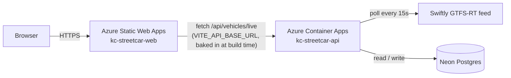
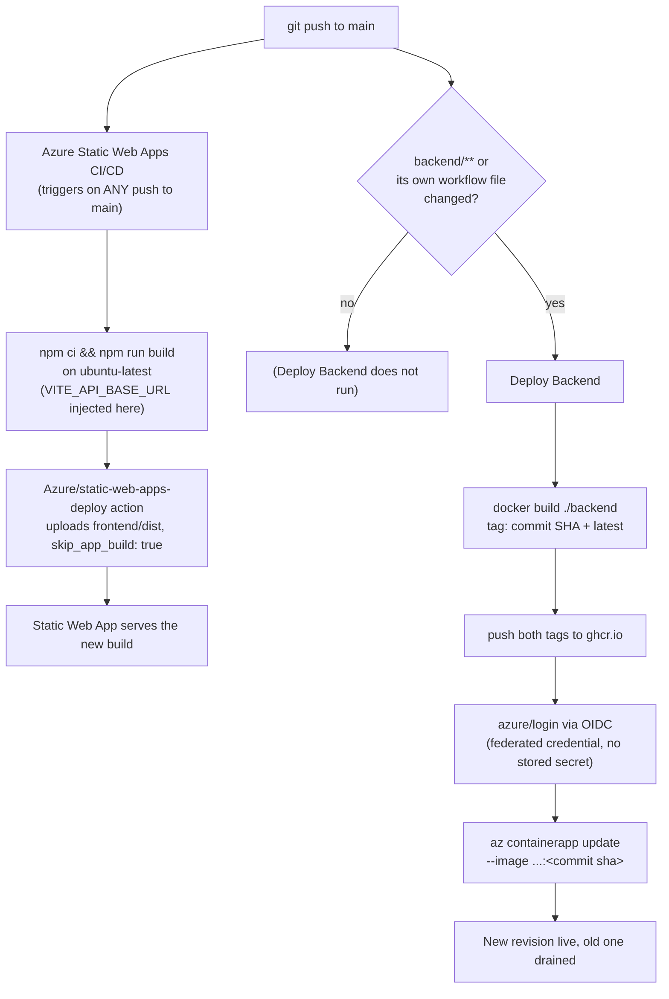

# CI/CD Pipeline

This is the living reference for how KC Streetcar Tracker is hosted and how deploys work. [deployment.md](./deployment.md) is the historical build log (the phased setup checklist, with the gotchas hit along the way); this doc is "how it works today."

## Quick reference

| Thing | Value |
|---|---|
| Frontend | https://proud-island-0a037380f.6.azurestaticapps.net |
| Backend API | https://kc-streetcar-api.mangoground-3203ab82.eastus2.azurecontainerapps.io |
| Resource group | `kc-streetcar` (East US 2) |
| Static Web App | `kc-streetcar-web` |
| Container App | `kc-streetcar-api` (Consumption plan, `kc-streetcar-env` environment) |
| Backend image | `ghcr.io/alexmwebber/kc-streetcar-backend` (public) |
| Database | Neon Postgres, project in `us-east-2` |
| Azure AD app (backend CI auth) | `kc-streetcar-github-actions`, client ID `09824957-b323-498c-a1fc-b041f534fb94` |
| Monthly budget alert | `kc-streetcar-monthly-20`, $20/mo, subscription-wide |

## Runtime architecture



The backend is one always-on process doing two jobs: serving the `/api/vehicles/*` and `/health` routes, and polling the GTFS-RT feed every 15s in the background ([poller.ts](../backend/src/services/poller.ts)). That's why the Container App is pinned to exactly one replica (`--min-replicas 1 --max-replicas 1`) - scale-to-zero would kill the poller, and more than one replica would mean duplicate polling and duplicate rows in Neon.

## Deploy pipeline

Two independent GitHub Actions workflows, split by which part of the repo changed:



**[azure-static-web-apps-proud-island-0a037380f.yml](../.github/workflows/azure-static-web-apps-proud-island-0a037380f.yml)** - triggers on every push to `main` (no path filter currently - a push that only touches the backend still re-runs this; harmless since it's fast and free, but a `paths: ["frontend/**", ...]` filter would be a clean improvement if it starts to bug you). Builds on the standard `ubuntu-latest` runner rather than letting the deploy action hand the build off to Azure's own auto-builder ("Oryx") - Oryx's build container has an older glibc than the Rollup native binary `vite build` pulls in, which fails outright (see deployment.md's Phase 4 notes). Auth is a deployment token Azure generated and stored as the `AZURE_STATIC_WEB_APPS_API_TOKEN_PROUD_ISLAND_0A037380F` repo secret when the Static Web App was created.

**[deploy-backend.yml](../.github/workflows/deploy-backend.yml)** - triggers only on pushes touching `backend/**` (or the workflow file itself). Builds and pushes the Docker image tagged *both* `:latest` and `:<commit-sha>`, then updates the Container App to that exact SHA tag. Tagging by SHA (rather than only `:latest`) means the running image is always traceable back to the exact commit that produced it, and makes rollback possible without rebuilding (see below).

## Auth: how the backend pipeline reaches Azure

No Azure credential is stored in GitHub as a plain secret. Instead:

1. An Azure AD app registration (`kc-streetcar-github-actions`) has a **federated credential** trusting GitHub's OIDC issuer for a specific subject: `repo:alexmwebber@26013687/kc-streetcar@1347814895:ref:refs/heads/main` (GitHub includes immutable owner/repo IDs in this claim, not just names).
2. On each run, GitHub's Actions runner mints a short-lived OIDC token asserting "I am a run of that exact repo/branch." The `azure/login@v2` step exchanges it for an Azure access token - no password or secret changes hands, and the token is only valid for that one job run.
3. The app registration's service principal has the **Container Apps Contributor** role, scoped to only the `kc-streetcar` resource group (not the whole subscription) - it can manage Container Apps there and nothing else.
4. `AZURE_CLIENT_ID` / `AZURE_TENANT_ID` / `AZURE_SUBSCRIPTION_ID` are stored as repo secrets, but they're just identifiers (which app registration, which tenant, which subscription) - useless to an attacker without also being able to mint a matching GitHub OIDC token for this exact repo/branch.

The frontend pipeline's auth is simpler: a deployment token scoped to just that one Static Web App, generated by Azure and stored as a secret automatically.

## Configuration and secrets

**Frontend (build-time only)** - `VITE_API_BASE_URL` is set as an `env:` on the workflow's build step and gets inlined into the JS bundle by Vite at build time ([vehicles.ts](../frontend/src/api/vehicles.ts)). It is *not* runtime-configurable - if the backend's URL ever changes, the frontend must be rebuilt and redeployed, not just restarted.

**Backend (Container App env vars / secrets)**, set via `az containerapp update`:

| Name | Kind | Value |
|---|---|---|
| `SWIFTLY_API_KEY` | secret (`swiftly-key`) | Swiftly GTFS-RT API key |
| `DATABASE_URL` | secret (`db-url`) | Neon pooled connection string (`sslmode=require&channel_binding=require`) |
| `GTFS_RT_URL` | plain | Swiftly feed URL |
| `STREETCAR_ROUTE_ID` | plain | `601` |
| `POLL_INTERVAL_MS` | plain | `15000` |
| `PORT` | plain | `3001` |
| `CORS_ORIGIN` | plain | `https://proud-island-0a037380f.6.azurestaticapps.net` (defaults to `*` if unset - see [config.ts](../backend/src/config.ts)) |

## Making a change

Just edit and push to `main` - there's no separate "deploy" step:

- Touch anything under `frontend/` → the Static Web Apps workflow rebuilds and redeploys (~1-2 min).
- Touch anything under `backend/` → the Deploy Backend workflow builds a new image and rolls it into Container Apps (~2-3 min).
- Touch both → both workflows run independently, in parallel.

To test a backend change locally first, without waiting on CI:
```
cd backend
npm run build
docker build -t kc-streetcar-backend .
docker run --rm -p 3001:3001 --env-file .env kc-streetcar-backend
```
For the frontend, `npm run dev` in `frontend/` uses the Vite dev proxy to `localhost:3001` (see [vite.config.ts](../frontend/vite.config.ts)), so no env var juggling is needed for local work.

## Rolling back

**Backend - two options:**
- *Fast, no rebuild:* every image is kept in `ghcr.io` tagged by commit SHA, so you can point the Container App straight at a known-good one: `az containerapp update -n kc-streetcar-api -g kc-streetcar --image ghcr.io/alexmwebber/kc-streetcar-backend:<old-sha>`. Instant, no CI run required.
- *Through the pipeline:* `git revert <bad-commit>` and push - rebuilds and redeploys the reverted code, and leaves a clean history of the rollback.

**Frontend:** `git revert` and push is the straightforward path (there's no separate image registry to point at an old build). Azure also keeps prior Static Web Apps deployments browsable from the portal if you need to eyeball an old version without touching git.

## Debugging a failed deploy

1. **GitHub Actions tab first** (`github.com/alexmwebber/kc-streetcar/actions`) - both workflows log every step; a failed run's red X links straight to the failing step's output.
2. **Backend runtime, once deployed:**
   - `az containerapp logs show -n kc-streetcar-api -g kc-streetcar --tail 50` - application logs (should show `API listening...` and steady `[poller] stored N position(s)` lines).
   - `az containerapp revision list -n kc-streetcar-api -g kc-streetcar -o table` - is the new revision healthy and actually receiving traffic, or stuck at 0%?
   - `az containerapp show -n kc-streetcar-api -g kc-streetcar --query properties.template.containers[0]` - confirms the exact image/env vars/probes currently live.
3. **Frontend deployment status:** `az staticwebapp environment list -n kc-streetcar-web -g kc-streetcar` - GitHub Actions logs are the main debugging tool here; Azure-side CLI visibility into SWA is thinner than for Container Apps.

**Known failure modes already hit once** (see deployment.md for full details):
- *`GLIBC_2.32' not found` during the frontend build* → Oryx auto-build issue, not your code; the workflow builds on `ubuntu-latest` itself specifically to avoid this.
- *`permission_denied: write_package` pushing to ghcr.io* → the package isn't linked for this repo's Actions access yet. Fix: package Settings → Manage Actions access → add the repo with Write.
- *`AADSTS700213: No matching federated identity record...`* → the federated credential's `subject` doesn't match what GitHub is presenting (e.g. after a repo rename/transfer, or GitHub changing its claim format). Fix: read the exact subject string out of the error and `az ad app federated-credential update` to match it.
- *An unescaped `&` (or `|`, `^`, `%`) in a value passed to `az` from PowerShell* → gets split by the `cmd.exe` layer `az.cmd` runs through, silently corrupting the command. Fix: put the value in a JSON/YAML file and pass `--parameters @file` / `--body @file` / `--yaml @file` instead of inlining it.

## Cost

Consumption-based, no fixed server cost:

| Piece | Cost |
|---|---|
| Container Apps (1 replica, 0.25 vCPU / 0.5 GiB, always on) | ~$4-6/mo |
| Static Web Apps (Free tier) | $0 |
| Neon Postgres (Free tier) | $0 |
| ghcr.io (public package) | $0 |
| **Total** | **~$4-6/mo** |

A $20/mo subscription-wide budget alert (`kc-streetcar-monthly-20`) fires at 80% actual, 100% actual, and 100% forecasted spend, emailing alexmwebber@gmail.com, as a safety net against surprises.
